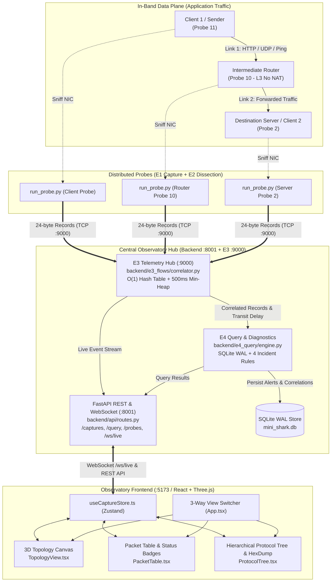

# Mini-Shark Codebase Architecture & File Reference Guide

Mini-Shark is an advanced, high-performance network protocol analysis and distributed telemetry observatory. It features a unified dual-mode architecture:
1. **Wireshark-Parity Packet Analyzer (Single-Host Mode):** Captures live wire traffic (via Linux `AF_PACKET` raw sockets or Windows `Scapy + Npcap`) or reads offline PCAP/PCAPNG captures, decodes protocols from Layer 2 through Layer 7 with exact field byte-spans, evaluates Wireshark display filter expressions using a full Lexer/AST compiler, aggregates bidirectional 5-tuple flows, persists data in SQLite WAL mode, and renders a classic 3-pane packet analyzer (Packet Table, Protocol Tree, and Hex Dump).
2. **Distributed Multi-Point Telemetry & Latency Tracing (Multi-Host Mode):** Deploys lightweight capture probes across multi-hop topologies (Clients, Intermediate Router, and Destination Server), calculates path-invariant 64-bit BLAKE2b fingerprints, streams compact 24-byte telemetry records over TCP port `9000` with MTU-aligned batching and Nagle disabling (`TCP_NODELAY = 1`), correlates packets in real time inside a 500 ms sliding min-heap window, localizes silent packet drops to Link 1 versus Link 2, runs 4 deterministic diagnostic rules, and animates live packet flights on an interactive 3D WebGL (Three.js) topology canvas.

---

## 1. System Pipeline Architecture



---

## 2. Core Engine Register & Division of Responsibilities

Following the curriculum specifications (`23ECNP301`, Team 07):

| Engine | Name | Primary Owner | Architectural Role | Core Algorithms & Implementation | Code Path |
| :--- | :--- | :--- | :--- | :--- | :--- |
| **E1** | **Capture & Ingestion** | M Janaki (`01fe24bci067`) | High-speed wire packet capture, interface sniffing, PCAP/PCAPNG ingestion, and batching buffers. | Linux `AF_PACKET` raw sockets, Windows `Scapy + Npcap`, `dpkt` binary PCAP parser, 50-pkt / 20ms queue flush. | [`backend/e1_capture/`](backend/e1_capture/) |
| **E2** | **Protocol Analysis & Dissection** | Chhavi Mishra (`01fe24bci066`) | Layered protocol decoding (L2–L7), field byte-offset tracking, path-invariant fingerprinting, and DNS entropy. | Layer Walker, Field Span Byte Mapper, BLAKE2b-64 invariant digest, Shannon entropy $H(X)$. | [`backend/e2_dissection/`](backend/e2_dissection/) |
| **E3** | **Flow & Multi-Point Correlation Hub** | Hrishikesh Patil (`01fe24bci043`) | 5-tuple flow aggregation, display filter parsing (in Wireshark mode), and TCP `:9000` multi-point correlation (in distributed mode). | $O(1)$ dual hash tables, 500 ms `heapq` binary min-heap, transit delay $\Delta T = T_2 - T_1$, Link 1 vs Link 2 drop localization. | [`backend/e3_flows/`](backend/e3_flows/) |
| **E4** | **Query, Storage & Diagnostics** | Vaibhav Kumar (`01fe24bci0...`) | SQLite WAL persistence, AST-to-SQL query compilation, automated root-cause incident detection, and REST/WebSocket delivery. | SQLite WAL mode (`mini_shark.db`), AST recursive-descent query engine, 4 deterministic anomaly rules, FastAPI + React UI. | [`backend/e4_query/`](backend/e4_query/), [`frontend/`](frontend/) |

---

## 3. Directory Layout & Complete File Map

```text
Mini_Shark/
├── .github/
│   └── workflows/
│       └── ci.yml                 # GitHub Actions CI workflow (linting, tests, package verification)
├── .gitignore                     # Repository ignore rules (cache, venv, databases, temp files)
├── .pre-commit-config.yaml        # Pre-commit hook configurations (Black, Ruff, YAML checks)
├── pyproject.toml                 # Build system, package metadata, and tool configs (pytest, ruff)
├── requirements.txt               # Python package dependencies
├── package.json                   # Top-level workspace script shortcuts
├── project_spec.txt               # Academic specification & team engine register
├── README.md                      # Primary repository documentation and unified quick start
├── CODEBASE_ARCHITECTURE.md       # Comprehensive codebase architecture & file reference (this document)
├── RESEARCH_AND_ARCHITECTURE.md   # Research blueprint, DPI specifications, and mathematical foundations
│
├── Root Runners & Demonstrations/
│   ├── run_minishark.py           # Universal one-laptop launcher (API :8001 + E3 :9000 + browser)
│   ├── live_demo.py               # Live Wi-Fi sniffer and dissection terminal demo
│   ├── run_e3_server.py           # Standalone CLI runner for the E3 Correlation Hub
│   ├── benchmark_e3.py            # High-throughput synthetic benchmark for E3 correlation engine
│   ├── test_anomalies.py          # End-to-end integration test validating the 4 diagnostic rules
│   ├── populate_demo_data.py      # Seed script populating SQLite with realistic multi-probe telemetry
│   ├── query_demo.py              # CLI demo executing Wireshark display filters against SQLite
│   ├── demo_e2.py                 # Terminal demo for protocol dissection and invariant hashing
│   ├── demo_e3.py                 # Terminal demo for real-time out-of-order stream correlation
│   └── run.sh                     # Automated shell launcher (venv setup, pip install, uvicorn run)
│
├── Distributed Testbed Scripts/
│   ├── run_probe.py               # High-throughput probe agent (client, router, server roles)
│   ├── run_probe.sh               # Zero-dependency Linux/macOS probe launcher wrapper
│   ├── run_probe.bat              # Zero-dependency Windows probe launcher wrapper
│   ├── start_server.sh            # Linux central hub runner (API + E3 + Vite UI + local probe 2)
│   ├── stop_server.sh             # Graceful process teardown script for background server jobs
│   ├── start_router.sh            # Linux intermediate router runner with L3 forwarding
│   ├── start_router.bat           # Windows router launcher wrapper
│   ├── start_router.ps1           # Windows PowerShell router runner with IP forwarding & NetEm faults
│   ├── start_client_linux.sh      # Arch/Ubuntu Linux client runner with traffic generator & probe
│   ├── start_client_windows.bat   # Windows client launcher wrapper
│   ├── start_client_windows.ps1   # Windows PowerShell client runner with traffic generation & probe
│   ├── setup_cross_laptop_network.bat # Windows netsh portproxy and firewall configurator
│   ├── setup_cross_laptop_network.ps1 # PowerShell cross-laptop networking and port forward helper
│   ├── setup_vm1.sh               # Ubuntu VM1 (Central Hub) network & dependency setup
│   └── setup_vm2.sh               # Ubuntu VM2 (Probe/Client) network & dependency setup
│
├── scripts/
│   ├── setup_router.sh            # Pure L3 Linux router setup with tc netem drop/delay injection
│   ├── setup_server_network.sh    # Linux server firewall and return route configurator
│   ├── setup_windows_router.ps1   # Windows PowerShell routing and packet forwarding configuration
│   ├── traffic_generator.py       # Multi-mode traffic generator (HTTP, UDP stream, TCP burst, DNS)
│   └── traffic_receiver.py       # Lightweight HTTP/UDP destination sink for client-to-client tests
│
├── backend/                       # Python Backend (Engines E1 – E4, API & Models)
│   ├── __init__.py                # Package initialization
│   ├── main.py                    # FastAPI application entrypoint with E3 lifespan & dashboard mount
│   ├── models.py                  # Canonical domain models, binary wire structs, and match flags
│   ├── interfaces.py              # Abstract Base Classes (ABCs) defining EngineE1–EngineE4 contracts
│   ├── errors.py                  # Custom exception hierarchy (MiniSharkError, FilterError, etc.)
│   ├── pipeline.py                # Batch pipeline orchestrator (Capture -> Dissect -> Flow -> Store)
│   ├── api/
│   │   ├── __init__.py            # API subpackage initialization
│   │   └── routes.py              # FastAPI endpoints (REST, SSE stream, WebSocket /ws/live)
│   ├── probe/
│   │   ├── __init__.py            # Probe client subpackage initialization
│   │   └── client.py              # TelemetryClient socket manager (MSHK preamble, 24B framing)
│   ├── e1_capture/
│   │   ├── __init__.py            # E1 subpackage exports
│   │   ├── engine.py              # CaptureEngine: offline PCAP/PCAPNG parser using dpkt
│   │   └── live.py                # AFPacketCapture (Linux) & LiveCapture (Windows Scapy/Npcap)
│   ├── e2_dissection/
│   │   ├── __init__.py            # E2 subpackage exports
│   │   ├── engine.py              # ProtocolDissector: layer walker, fingerprinting, Shannon entropy
│   │   ├── protocols.py           # Dissectors for Ethernet, ARP, IPv4, IPv6, TCP, UDP, ICMP, DNS, HTTP
│   │   └── registry.py            # Protocol dispatch registry routing byte slices to layer dissectors
│   ├── e3_flows/
│   │   ├── __init__.py            # E3 subpackage exports
│   │   ├── __main__.py            # Standalone CLI entrypoint for running the E3 correlation hub
│   │   ├── correlator.py          # CorrelationHub: O(1) hash tables, 500ms min-heap, link drop isolation
│   │   ├── engine.py              # FlowGrouper: 5-tuple bidirectional conversation aggregation
│   │   ├── correlation.py         # Packet correlation helpers and data transformation utilities
│   │   └── ingestion.py           # Low-level TCP telemetry ingestion protocol handling
│   ├── e4_query/
│   │   ├── __init__.py            # E4 subpackage exports
│   │   ├── engine.py              # QueryEngine: unified coordinator for store, query, and diagnostics
│   │   ├── storage.py             # CaptureStore: SQLite repository with Write-Ahead Logging (WAL)
│   │   ├── filters.py             # Wireshark display filter Lexer, recursive-descent AST, SQL compiler
│   │   └── diagnostics.py         # 4 deterministic incident rules (Loss, Bufferbloat, Freeze, DNS exfil)
│   └── static/
│       └── index.html             # Pre-built standalone fallback dashboard served at root
│
├── frontend/                      # React 19 + Vite + Tailwind + Three.js Dashboard
│   ├── index.html                 # HTML shell and entry point
│   ├── package.json               # Frontend dependencies and npm scripts
│   ├── package-lock.json          # Deterministic dependency lockfile
│   ├── tsconfig.json              # TypeScript root configuration
│   ├── tsconfig.app.json          # TypeScript application configuration
│   ├── tsconfig.node.json         # TypeScript Vite configuration
│   ├── vite.config.ts             # Vite build and dev-server configuration
│   ├── .oxlintrc.json             # Linter configuration
│   ├── README.md                  # Frontend-specific architecture and component documentation
│   ├── public/                    # Static assets, SVG icons, and fallback pages
│   └── src/
│       ├── main.tsx               # React application bootstrapping
│       ├── App.tsx                # Main view layout and 3-way view switcher
│       ├── App.css / index.css    # Tailwind CSS imports and custom utility styles
│       ├── config.ts              # Dynamic API and WebSocket host resolution
│       ├── types.ts               # Complete TypeScript type definitions matching backend models
│       ├── components/
│       │   ├── HeaderBar.tsx      # Navigation bar, probe status pills, client tags, filter search box
│       │   ├── SimulationBar.tsx  # Mode switcher (Live vs Demo) and synthetic fault injection buttons
│       │   ├── TopologyView.tsx   # Three.js 3D WebGL scene with animated packet flights and drop rings
│       │   ├── Inspector.tsx      # Container housing PacketTable, ProtocolTree, and HexDump
│       │   ├── PacketTable.tsx    # Tabular list of packets with status badges and transit latency deltas
│       │   └── ProtocolTree.tsx   # Hierarchical layer tree with invariant highlights and raw Hex Dump
│       ├── lib/
│       │   ├── topology.ts        # 3D spatial node coordinates and quadratic Bézier curve mathematics
│       │   └── frames.ts          # Mock telemetry generators and Wireshark frame parsers
│       └── store/
│           └── useCaptureStore.ts # Central Zustand store managing WebSocket feeds, metrics, and filter state
│
├── tests/unit/                    # Comprehensive Pytest Suite (153 Tests)
│   ├── helpers.py                 # Test fixtures, raw frame constructors (Ethernet/IP/TCP/UDP/DNS)
│   ├── test_academic_cases.py     # Academic syllabus validation test cases
│   ├── test_api.py                # REST endpoints and OpenAPI schema smoke tests
│   ├── test_batching.py           # Telemetry client 50-pkt / 20ms queue flush tests
│   ├── test_e1_capture.py         # DPKT/Scapy PCAP loader tests
│   ├── test_e1_live.py            # Live capture socket tests and loop-back filter validation
│   ├── test_e2_dissection.py      # Layer-by-layer protocol parsing tests
│   ├── test_e2_fingerprint.py     # Path-invariance property tests for BLAKE2b-64 digest
│   ├── test_e3_correlation.py     # Out-of-order, late arrival, and link drop correlation tests
│   ├── test_e3_flows.py           # 5-tuple flow grouping tests
│   ├── test_e3_ingestion.py       # TCP :9000 protocol framing, preamble, and heartbeat tests
│   ├── test_e4_query.py           # Wireshark AST filter parsing and SQLite storage tests
│   ├── test_errors.py             # Error hierarchy and validation tests
│   └── test_pipeline.py           # End-to-end batch analysis pipeline tests
│
└── docs/                          # In-Depth Project Documentation & Specifications
    ├── README.md                  # Detailed system documentation and technical manual
    ├── system_architecture_diagram.md # Comprehensive Mermaid architecture and network diagrams
    ├── data_contract.md           # Engine-to-engine data contract, binary wire structs, and schema
    ├── api_routes.md              # Complete specification of all REST, SSE, WS, and TCP interfaces
    ├── implementation.md          # 7-phase implementation roadmap, acceptance criteria, and milestones
    ├── four_laptop_deployment_guide.md # Step-by-step physical lab runbook for 4 distinct laptops
    ├── physical_lab_setup.md      # Scaling guide: 3-laptop pilot deployment to 8–50 PC lab networks
    ├── laptop2_setup_guide.md     # Dedicated guide for configuring Laptop 2 (Client 2 / Receiver)
    ├── two_probe_deployment.md    # Two-machine distributed setup plan
    ├── vm_network_setup.md        # VMware / VirtualBox bridged VM network configuration guide
    ├── phase4-verification.md     # Empirical verification and synthetic benchmark results
    ├── phase4-benchmark.json      # Raw JSON benchmark data for E3 correlation engine
    └── CONTRIBUTING.md            # Contribution guidelines, branch conventions, and contract change rules
```

---

## 4. In-Depth Backend Subsystem Reference

### 4.1. Domain Models (`backend/models.py`)
`models.py` serves as the contract across all four engines:
* **`Packet`**: Immutable representation of a raw frame (`index`, `timestamp`, `length`, `raw_bytes`).
* **`Layer`**: An individual protocol layer containing its `name`, a dictionary of parsed `fields`, and any trailing `undecoded_bytes`.
* **`DecodedPacket`**: The complete hierarchical representation containing the full list of `Layer` objects, the computed 64-bit `PacketFingerprint`, and optional DNS Shannon entropy `dns_entropy`.
* **`PacketFingerprint`**: Contains `algorithm` (`"blake2b-64"`), `version` (1), `value` (64-bit integer), and `fields_used`.
* **`ProbeTelemetry`**: The compact 24-byte wire struct exchanged over TCP `:9000`:
  ```text
  0                   1                   2                   3
  0 1 2 3 4 5 6 7 8 9 0 1 2 3 4 5 6 7 8 9 0 1 2 3 4 5 6 7 8 9 0 1
  +-+-+-+-+-+-+-+-+-+-+-+-+-+-+-+-+-+-+-+-+-+-+-+-+-+-+-+-+-+-+-+-+
  |                     64-bit Fingerprint                        |
  +-+-+-+-+-+-+-+-+-+-+-+-+-+-+-+-+-+-+-+-+-+-+-+-+-+-+-+-+-+-+-+-+
  |                  64-bit Timestamp (ns)                        |
  +-+-+-+-+-+-+-+-+-+-+-+-+-+-+-+-+-+-+-+-+-+-+-+-+-+-+-+-+-+-+-+-+
  |                     32-bit Sequence No                        |
  +-+-+-+-+-+-+-+-+-+-+-+-+-+-+-+-+-+-+-+-+-+-+-+-+-+-+-+-+-+-+-+-+
  |    Probe ID   |  Type / Ver   |       Captured Length         |
  +-+-+-+-+-+-+-+-+-+-+-+-+-+-+-+-+-+-+-+-+-+-+-+-+-+-+-+-+-+-+-+-+
  ```
* **`TelemetryPreamble`**: 16-byte connection header (`MSHK\x01\x18\x00\x00` + 32-bit epoch timestamp + reserved bytes).
* **`CorrelationRecord`**: Match result produced by E3 (`fingerprint`, `probe1_observed`, `probe2_observed`, `t1_ns`, `t2_ns`, `delay_ns`, `match_state`, `flags`, `router_observed`, `drop_link`).
* **`DiagnosticAlert`**: Automated incident alerts (`category`, `severity`, `confidence`, `detected_at_ns`, `recommended_action`, `metrics`).
* **`Flow`**: 5-tuple conversation grouping (`flow_id`, `five_tuple`, `packet_indices`, `packet_count`, `byte_count`, `start_ts`, `end_ts`, `duration`).

### 4.2. Engine E1: Capture & Ingestion (`backend/e1_capture/`)
* **`engine.py` (`CaptureEngine`)**: Parses offline PCAP and PCAPNG files using `dpkt` (with graceful fallback). Extracts epoch timestamps with microsecond or nanosecond precision and streams `Packet` instances.
* **`live.py` (`AFPacketCapture` / `LiveCapture`)**:
  - On Linux: Allocates a raw network socket using `socket(AF_PACKET, SOCK_RAW, htons(ETH_P_ALL))`. Zero dependencies, kernel-level timestamping, minimal CPU overhead.
  - On Windows: Uses Scapy bound to Npcap kernel driver (`\Device\NPF_{GUID}`) in promiscuous mode.
  - Automatic loop avoidance: Automatically filters out probe control traffic directed to port `9000` or local SSH/Vite ports.

### 4.3. Engine E2: Dissection & Fingerprinting (`backend/e2_dissection/`)
* **`engine.py` (`ProtocolDissector`)**: Iterates through protocol headers using `_walk()`. For each layer, records field values and exact byte spans `(start_offset, length)` for UI highlighting.
* **`protocols.py`**: Dissectors for Ethernet II, 802.1Q VLAN, ARP, IPv4, IPv6, TCP, UDP, ICMP, DNS, HTTP/1.x, and TLS ClientHello.
* **Path-Invariant Hashing**: Extracts `ip.src`, `ip.dst`, `ip.proto`, `ip.id`, `tcp.seq`, `tcp.ack`, and payload prefix while strictly excluding mutable fields (TTL, IP header checksum, MAC addresses, TCP/UDP checksums). Hashes the canonical byte representation with BLAKE2b (8-byte output).
* **Shannon Entropy**: Calculates $H(X) = -\sum p(x) \log_2 p(x)$ across DNS query strings to catch base64/hex-encoded data exfiltration tunnels.

### 4.4. Engine E3: Flow & Correlation Hub (`backend/e3_flows/`)
* **`correlator.py` (`CorrelationHub`)**: Runs an asynchronous TCP server on port `9000`.
  - Maintains dual hash tables: `_table` (ingress records awaiting egress) and `_table_p2` (egress records arriving earlier than ingress).
  - Uses an in-memory priority queue (`heapq`) sorted by expiration deadline ($T_1 + 500\text{ ms}$).
  - Multi-Hop Drop Localization: When Probe 10 (Transit Router) is active, missing packets are attributed to **Link 1** (Client $\to$ Router) if Probe 10 never saw them, or **Link 2** (Router $\to$ Server) if Probe 10 saw them but Probe 2 did not.
* **`engine.py` (`FlowGrouper`)**: Aggregates decoded packets into directional conversations keyed by `(src_ip, dst_ip, src_port, dst_port, protocol)`.

### 4.5. Engine E4: Storage, Query & Diagnostics (`backend/e4_query/`)
* **`storage.py` (`CaptureStore`)**: High-throughput SQLite repository configured with Write-Ahead Logging (`PRAGMA journal_mode = WAL`) and synchronous normal mode. Stores captures, decoded packets, correlation flights, and diagnostic incidents.
* **`filters.py`**: Wireshark display filter engine. Features a lexical tokenizer, recursive-descent AST parser, and an in-memory evaluator plus SQL compiler supporting complex boolean logic (`&&`, `||`, `!`, `==`, `!=`, `<`, `>`).
* **`diagnostics.py`**: Four deterministic incident detection rules:
  1. `rule_packet_loss`: Triggers when dropped packet percentage exceeds 5%.
  2. `rule_bufferbloat`: Triggers when one-way transit delay exceeds 20 ms with high variance.
  3. `rule_app_freeze`: Detects connection stalls where packets flow but the remote peer ceases acknowledgments.
  4. `rule_dns_exfil`: Triggers when DNS subdomain Shannon entropy exceeds 4.2 bits.

### 4.6. API & Probe Client (`backend/api/` & `backend/probe/`)
* **`backend/api/routes.py`**: Exposes FastAPI endpoints for captures, inspector data, flows, statistics, live capture streaming, probe connection statuses, and `/ws/live` WebSocket push notifications.
* **`backend/probe/client.py` (`TelemetryClient`)**: Handles resilient probe-to-hub communication, including 16-byte connection preambles, 24-byte record packing, automatic reconnection with backoff, zero Nagle delays (`TCP_NODELAY = 1`), and idle heartbeat transmission.

---

## 5. Frontend Architecture (React + Three.js)

The frontend is built with React 19, TypeScript, Vite, Tailwind CSS, Zustand, and React-Three-Fiber.

### 5.1. 3-Way View Switcher (`App.tsx`)
Users can dynamically switch between three views using the header toggle:
1. **Split View (Default):** Displays the 3D WebGL Topology Canvas in the upper pane and the 3-pane Wireshark Inspector in the lower pane.
2. **3D Topology Canvas:** Maximizes the interactive WebGL scene for live network flow and latency monitoring.
3. **Wireshark Panes:** Maximizes the classic 3-pane packet analysis interface (Packet Table, Protocol Tree, and Hex Dump).

### 5.2. Component Breakdown
* **`HeaderBar.tsx`**: Shows Mini-Shark branding, live probe status pills (Client, Router, Server), active client source tags, and the Wireshark search filter bar.
* **`SimulationBar.tsx`**: Provides controls to switch between Live Network mode and Demo Simulation mode, with instant fault-injection buttons (Inject 5% Drops, Inject 60ms Delay, Inject DNS Burst).
* **`TopologyView.tsx`**: Renders the 3D scene using Three.js:
  - Renders physical fiber cables using glowing shader lines.
  - Animates `PacketParticle` meshes moving along quadratic Bézier curves.
  - Displays expanding red shockwave rings at the exact cable location where silent drops occur.
  - Interactive probe nodes with tooltips and packet counters.
* **`PacketTable.tsx`**: Displays the live virtualized packet list with client source tags (`[C1]`, `[C2]`), protocol badges, calculated transit latency $\Delta T$, and loss indicators.
* **`ProtocolTree.tsx`**: Hierarchical tree viewer for decoded layers. Path-invariant fields are highlighted in cyan, mutable fields (TTL, Checksum) have strikethrough styling, and payload bytes are displayed in an interactive Hex Dump viewer.
* **`useCaptureStore.ts`**: Central Zustand state store managing WebSocket streams, ring buffers (up to 240 recent packets), client node discovery, and filter evaluation.
