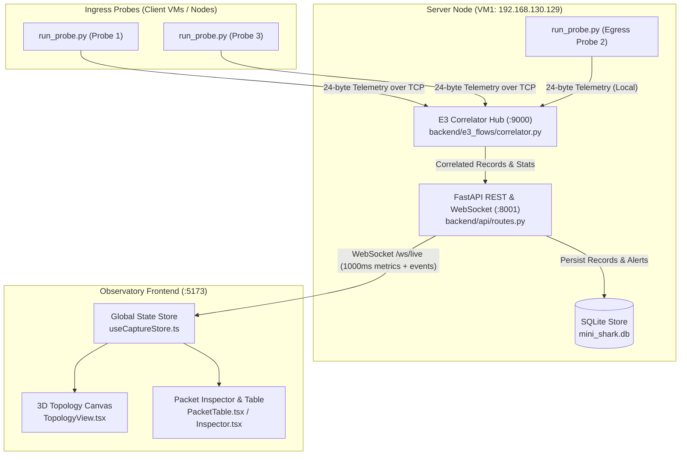
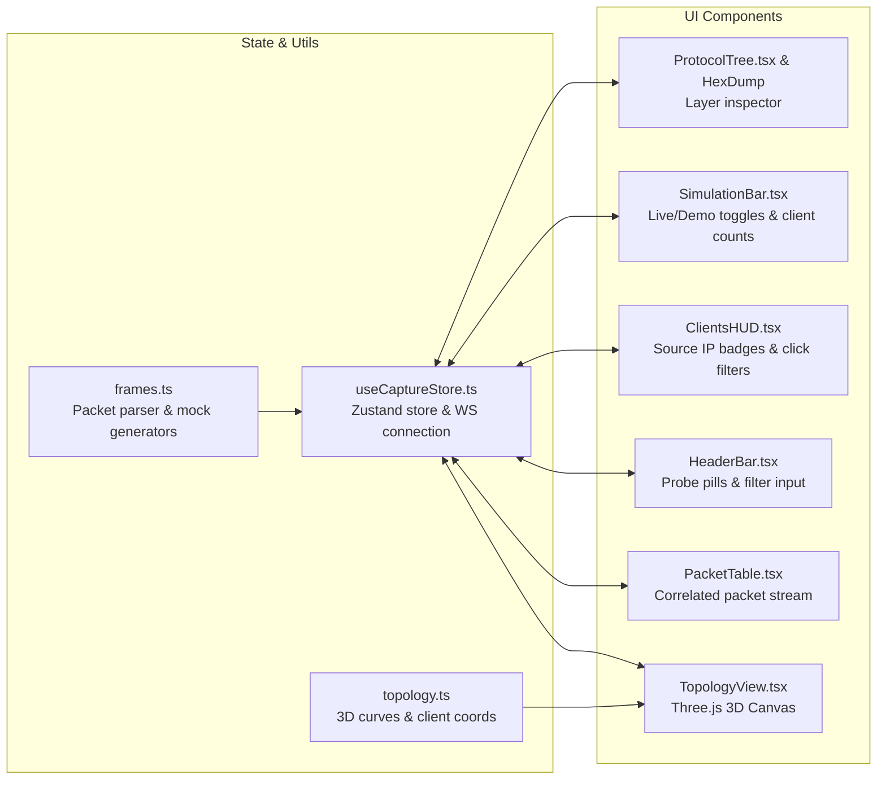

# Mini-Shark Codebase Architecture & File Reference Guide

Mini-Shark is a distributed, high-performance network latency and packet-loss observatory. It traces packets across multi-hop network topologies by calculating **path-invariant fingerprints** (BLAKE2b-64) at distributed ingress probes, correlating them against egress probe observations in real-time at a central hub, and visualizing traffic, latency spikes, and silent drops on an interactive 3D WebGL dashboard.

---



---

## 1. System Pipeline Overview (E1 – E4)

Mini-Shark is divided into four cleanly decoupled backend engines:

| Engine | Name | Primary Role | Key Technology |
| :--- | :--- | :--- | :--- |
| **E1** | **Capture Engine** | Raw packet acquisition from interfaces or files | Linux `AF_PACKET`, `pcap`/`pcapng`, Scapy |
| **E2** | **Dissection Engine** | Layer decoding & path-invariant fingerprinting | Layer Walker, BLAKE2b-64, Shannon Entropy |
| **E3** | **Flow & Correlation Hub** | Bidirectional TCP streaming & out-of-order correlation | Asyncio TCP Server, Min-Heap, 500ms Sliding Window |
| **E4** | **Query & Diagnostics** | SQL persistence, Wireshark filter compiler & automated rules | SQLite WAL, Lexer/Parser, 4 Diagnostic Rules |

---

## 2. Root Executables & Scripts

### [`run_probe.py`](file:///C:/Users/chhav/OneDrive/Desktop/mini_shark/run_probe.py)
* **Purpose**: Live capture agent designed to run as a daemon on client machines (ingress) or the destination server (egress).
* **Key Logic**:
  1. Parses command line arguments: `--probe-id`, `--server`, `--iface`, `--filter`.
  2. Resolves network interface (`_pick_linux_interface` or Windows fallback).
  3. Connects to the central E3 hub using `TelemetryClient` over TCP port 9000, transmitting a 16-byte preamble (`MSHK\x01\x18` + `probe_id`).
  4. In a high-throughput loop, captures raw frames using `get_live_capturer` (`AF_PACKET` socket on Linux).
  5. Decodes invariant packet headers via `ProtocolDissector` and extracts a 64-bit BLAKE2b fingerprint.
  6. Packs the fingerprint, sequence counter, and microsecond/nanosecond timestamp into a compact 24-byte wire struct (`ProbeTelemetry`) and streams it over TCP.
  7. Sends idle keepalive heartbeats if traffic ceases for > 5 seconds to maintain connection health.

### [`run_e3_server.py`](file:///C:/Users/chhav/OneDrive/Desktop/mini_shark/run_e3_server.py)
* **Purpose**: Standalone CLI runner for the E3 Correlation Hub.
* **Key Logic**:
  - Initializes `CorrelationHub(timeout_ms=500, probe1_id=1, probe2_id=2)`.
  - Binds asyncio TCP server on `0.0.0.0:9000` to receive telemetry streams from distributed probes.

### [`benchmark_e3.py`](file:///C:/Users/chhav/OneDrive/Desktop/mini_shark/benchmark_e3.py)
* **Purpose**: Performance and stress benchmarking suite for Engine E3.
* **Key Logic**:
  - Generates synthetic packet bursts (matched pairs, late packets, silent drops, and out-of-order deliveries).
  - Asserts that throughput exceeds 10,000 matches/sec and that heap memory compaction properly evicts dead observations.

### [`demo_e2.py`](file:///C:/Users/chhav/OneDrive/Desktop/mini_shark/demo_e2.py) & [`demo_e3.py`](file:///C:/Users/chhav/OneDrive/Desktop/mini_shark/demo_e3.py)
* **Purpose**: Terminal-based demonstration scripts showcasing invariant fingerprinting and real-time out-of-order stream correlation.

### [`test_anomalies.py`](file:///C:/Users/chhav/OneDrive/Desktop/mini_shark/test_anomalies.py)
* **Purpose**: End-to-end integration test validating the four automated diagnostic rules (Packet Loss, Bufferbloat, Application Freeze, and DNS Tunneling).

### [`setup_cross_laptop_network.bat`](file:///C:/Users/chhav/OneDrive/Desktop/mini_shark/setup_cross_laptop_network.bat) / [`.ps1`](file:///C:/Users/chhav/OneDrive/Desktop/mini_shark/setup_cross_laptop_network.ps1)
* **Purpose**: Windows administrative script configuring `netsh interface portproxy` rules (forwarding ports 8001, 9000, 22 to VM1), Windows Firewall rules, and routing table entries.

### [`setup_vm1.sh`](file:///C:/Users/chhav/OneDrive/Desktop/mini_shark/setup_vm1.sh) & [`setup_vm2.sh`](file:///C:/Users/chhav/OneDrive/Desktop/mini_shark/setup_vm2.sh)
* **Purpose**: Shell provisioning scripts for Ubuntu VMs to configure virtual interfaces (`ens33`), install system dependencies, build virtual environments, and grant `cap_net_raw` permissions.

---

## 3. Backend Core & Pipeline

### [`backend/models.py`](file:///C:/Users/chhav/OneDrive/Desktop/mini_shark/backend/models.py)
* **Purpose**: Canonical domain models and binary wire formats across all engines.
* **Core Classes**:
  - `Packet`: Raw packet representation with capture timestamp, wire length, payload, and link-layer metadata.
  - `Layer`: Protocol layer container (`name`, `fields` dictionary, `undecoded_bytes`).
  - `DecodedPacket`: Packet with its complete decoded layer stack, extracted five-tuple, 64-bit fingerprint, and Shannon entropy.
  - `Flow`: Bi-directional conversation grouping aggregated by normalized 5-tuple with timing and byte statistics.
  - `ProbeTelemetry`: 24-byte binary wire struct exchanged between probe agents and the correlation hub:
    ```
    0                   1                   2                   3
    0 1 2 3 4 5 6 7 8 9 0 1 2 3 4 5 6 7 8 9 0 1 2 3 4 5 6 7 8 9 0 1
    +-+-+-+-+-+-+-+-+-+-+-+-+-+-+-+-+-+-+-+-+-+-+-+-+-+-+-+-+-+-+-+-+
    |                     64-bit Fingerprint                        |
    +-+-+-+-+-+-+-+-+-+-+-+-+-+-+-+-+-+-+-+-+-+-+-+-+-+-+-+-+-+-+-+-+
    |                  64-bit Timestamp (ns)                        |
    +-+-+-+-+-+-+-+-+-+-+-+-+-+-+-+-+-+-+-+-+-+-+-+-+-+-+-+-+-+-+-+-+
    |       16-bit Probe ID         |       16-bit Cap Length       |
    +-+-+-+-+-+-+-+-+-+-+-+-+-+-+-+-+-+-+-+-+-+-+-+-+-+-+-+-+-+-+-+-+
    |                     32-bit Sequence No                        |
    +-+-+-+-+-+-+-+-+-+-+-+-+-+-+-+-+-+-+-+-+-+-+-+-+-+-+-+-+-+-+-+-+
    ```
  - `CorrelationRecord`: The matched/unmatched result between Ingress and Egress probes, including transit delay $\Delta T = T_2 - T_1$ and clock skew flags.
  - `DiagnosticAlert`: Incident alerts flagged by automated diagnostic rules (`packet_loss`, `bufferbloat`, `app_freeze`, `dns_tunneling`).

### [`backend/errors.py`](file:///C:/Users/chhav/OneDrive/Desktop/mini_shark/backend/errors.py)
* **Purpose**: Centralized custom exception hierarchy (`MiniSharkError`, `FilterSyntaxError`, `CorrelatorTimeoutError`, `StorageError`).

### [`backend/interfaces.py`](file:///C:/Users/chhav/OneDrive/Desktop/mini_shark/backend/interfaces.py)
* **Purpose**: Abstract Base Classes (ABCs) enforcing interface contracts for `EngineE1`, `EngineE2`, `EngineE3`, and `EngineE4`.

### [`backend/pipeline.py`](file:///C:/Users/chhav/OneDrive/Desktop/mini_shark/backend/pipeline.py)
* **Purpose**: Pure batch analysis orchestrator.
* **Key Function**: `analyze(file_path)` sequentially executes `CaptureLoader -> ProtocolDissector -> FlowGrouper -> QueryEngine.store` to ingest static trace files into the database.

### [`backend/main.py`](file:///C:/Users/chhav/OneDrive/Desktop/mini_shark/backend/main.py)
* **Purpose**: Application entrypoint.
* **Key Logic**: Initializes FastAPI with CORS middleware, mounts REST routes from `backend.api.routes`, and triggers background startup of the E3 TCP hub on port 9000.

---

## 4. Backend Subsystems

### Engine E1: Capture Subsystem
* [`backend/e1_capture/engine.py`](file:///C:/Users/chhav/OneDrive/Desktop/mini_shark/backend/e1_capture/engine.py):
  Reads offline PCAP and PCAP-NG files using `dpkt` (with resilient Scapy fallback). Extracts packet timestamps and handles microsecond vs nanosecond precision headers.
* [`backend/e1_capture/live.py`](file:///C:/Users/chhav/OneDrive/Desktop/mini_shark/backend/e1_capture/live.py):
  Provides `AFPacketCapture`, utilizing Linux `socket(AF_PACKET, SOCK_RAW, htons(ETH_P_ALL))` to capture raw Ethernet frames with minimal overhead. Automatically resolves the active network interface and prevents loops by ignoring probe traffic to `:9000`.

### Engine E2: Dissection & Fingerprinting Subsystem
* [`backend/e2_dissection/engine.py`](file:///C:/Users/chhav/OneDrive/Desktop/mini_shark/backend/e2_dissection/engine.py):
  - `_walk()`: Traverses link, network, transport, and application layers until reaching payload or unparsed bytes.
  - `_compute_fingerprint()`: Feeds extracted path-invariant bytes into `hashlib.blake2b(digest_size=8)` to produce a 64-bit integer fingerprint.
  - `_dns_shannon_entropy()`: Calculates character entropy $H(X) = -\sum p \log_2(p)$ across DNS query strings to catch encoded tunneling.
* [`backend/e2_dissection/registry.py`](file:///C:/Users/chhav/OneDrive/Desktop/mini_shark/backend/e2_dissection/registry.py):
  Maintains the dispatch table that routes parsed bytes to specific protocol dissectors based on preceding headers (EtherType, IP protocol, TCP/UDP port).
* [`backend/e2_dissection/protocols.py`](file:///C:/Users/chhav/OneDrive/Desktop/mini_shark/backend/e2_dissection/protocols.py):
  Dissectors for Ethernet, VLAN, ARP, IPv4, IPv6, TCP, UDP, ICMP, DNS, HTTP.
  Contains `extract_invariant_fields()`, which filters out mutable fields (TTL, Checksum, IP TOS) and keeps only path-invariant fields (`ip.src`, `ip.dst`, `ip.proto`, `ip.id`, `tcp.seq`, `tcp.ack`, payload prefix).

### Engine E3: Flow & Correlation Subsystem
* [`backend/e3_flows/correlator.py`](file:///C:/Users/chhav/OneDrive/Desktop/mini_shark/backend/e3_flows/correlator.py):
  - Manages the `CorrelationHub` and the asyncio TCP server on `:9000`.
  - **Bidirectional Ingestion**:
    - When Ingress Probe (P1/P3) telemetry arrives, it checks if Egress Probe (P2) has already recorded the packet in `_table_p2`. If yes, it computes latency $\Delta T = T_2 - T_1$, generates a `matched` `CorrelationRecord`, and notifies listeners. If not, it buffers in `_table` with a min-heap deadline.
    - When Egress Probe (P2) telemetry arrives first (out-of-order), it matches against `_table`, or buffers in `_table_p2`.
  - **Eviction Loop**: Periodically pops expired entries from the min-heap. Unmatched ingress entries after 500ms are marked as `unmatched` (silent drop on the wire).
  - `probe_status()`: Returns active probe connections, deduplicating connections and exposing live client IPs.
* [`backend/e3_flows/engine.py`](file:///C:/Users/chhav/OneDrive/Desktop/mini_shark/backend/e3_flows/engine.py):
  `FlowGrouper`: Groups packets into directional 5-tuple conversations and computes aggregate packet, byte, and duration metrics.

### Engine E4: Storage, Query & Diagnostics Subsystem
* [`backend/e4_query/storage.py`](file:///C:/Users/chhav/OneDrive/Desktop/mini_shark/backend/e4_query/storage.py):
  `CaptureStore`: High-speed SQLite repository utilizing Write-Ahead Logging (`PRAGMA journal_mode = WAL`) and prepared statements to persist captures, decoded packets, correlation records, and diagnostic alerts.
* [`backend/e4_query/filters.py`](file:///C:/Users/chhav/OneDrive/Desktop/mini_shark/backend/e4_query/filters.py):
  Tokenizer, recursive descent parser, and SQL compiler supporting Wireshark display filter syntax (e.g. `ip.src == 192.168.130.128 && tcp.port == 80`).
* [`backend/e4_query/diagnostics.py`](file:///C:/Users/chhav/OneDrive/Desktop/mini_shark/backend/e4_query/diagnostics.py):
  Contains the four root-cause incident detection engines:
  1. `rule_packet_loss`: Triggers when dropped packet percentage exceeds 5%.
  2. `rule_bufferbloat`: Triggers when latency spikes exceed 60ms with significant jitter.
  3. `rule_app_freeze`: Identifies stall intervals where network packets flow normally but the application fails to respond.
  4. `rule_dns_exfil`: Flags suspicious Shannon entropy ($H > 3.8$) in DNS subdomains.

### API & Network Daemon
* [`backend/api/routes.py`](file:///C:/Users/chhav/OneDrive/Desktop/mini_shark/backend/api/routes.py):
  - REST endpoints for `/health`, `/probes`, `/correlations/stats`, `/captures`, `/flows`, `/alerts`.
  - `/ws/live`: Persistent WebSocket streaming live correlation events and 1-second system metrics to dashboard clients.
* [`backend/probe/client.py`](file:///C:/Users/chhav/OneDrive/Desktop/mini_shark/backend/probe/client.py):
  `TelemetryClient`: Handles socket lifecycle for probe agents, including exponential-backoff reconnects, 16-byte protocol negotiation, and framed 24-byte telemetry dispatch.

---

## 5. Frontend Architecture (React + Three.js)



### Core Configuration & State
* [`frontend/src/config.ts`](file:///C:/Users/chhav/OneDrive/Desktop/mini_shark/frontend/src/config.ts):
  Dynamically detects browser host to configure API (`http://192.168.130.129:8001`) and WebSocket (`ws://192.168.130.129:8001/ws/live`) endpoints across physical/VM testbeds.
* [`frontend/src/types.ts`](file:///C:/Users/chhav/OneDrive/Desktop/mini_shark/frontend/src/types.ts):
  Full TypeScript type definitions for `Packet`, `Flight`, `ClientNodeInfo`, `ProtocolLayer`, `ProbesStatus`, and `CorrelationRecord`.
* [`frontend/src/store/useCaptureStore.ts`](file:///C:/Users/chhav/OneDrive/Desktop/mini_shark/frontend/src/store/useCaptureStore.ts):
  Central Zustand store holding application state:
  - Connects to `/ws/live` and polls `/probes` every 2 seconds.
  - Automatically updates client definitions based on active ingress probe IPs.
  - Maps incoming correlation events to particle flight animations and updates the ring buffer of recent packets (max 240).
  - Provides display filter matching (`packetMatchesFilter`).

### 3D Visualization & Canvas
* [`frontend/src/lib/topology.ts`](file:///C:/Users/chhav/OneDrive/Desktop/mini_shark/frontend/src/lib/topology.ts):
  Defines 3D coordinates for clients, router hub, and server node. Computes memoized quadratic Bézier curves (`getClientCurve`, `curveOut`) for smooth particle flight interpolation.
* [`frontend/src/components/TopologyView.tsx`](file:///C:/Users/chhav/OneDrive/Desktop/mini_shark/frontend/src/components/TopologyView.tsx):
  React-Three-Fiber WebGL scene:
  - Renders physical cable geometry with dynamic glowing shader cores.
  - Animates `PacketParticle` meshes traversing the Bézier cables.
  - Visualizes silent drops with red shockwave rings at the point of loss.
  - Displays interactive `ProbeNode` components for clients, router hub, and destination server.
* [`frontend/src/components/ClientsHUD.tsx`](file:///C:/Users/chhav/OneDrive/Desktop/mini_shark/frontend/src/components/ClientsHUD.tsx):
  Floating overlay displaying active traffic source nodes (`[C1]`, `[C2]`) with one-click filtering by source IP.

### Packet Inspection & Controls
* [`frontend/src/components/HeaderBar.tsx`](file:///C:/Users/chhav/OneDrive/Desktop/mini_shark/frontend/src/components/HeaderBar.tsx):
  Top navigation header displaying Mini-Shark status badges, live probe connection pills, and Wireshark search filter box.
* [`frontend/src/components/PacketTable.tsx`](file:///C:/Users/chhav/OneDrive/Desktop/mini_shark/frontend/src/components/PacketTable.tsx):
  Tabular packet list with status badges (`✅ Matched`, `❌ Dropped on Wire`, `⚠️ High Latency`), client tags, protocol labels, and computed transit deltas.
* [`frontend/src/components/ProtocolTree.tsx`](file:///C:/Users/chhav/OneDrive/Desktop/mini_shark/frontend/src/components/ProtocolTree.tsx):
  Hierarchical dissection pane showing Ethernet $\to$ IPv4 $\to$ TCP/UDP $\to$ Invariants. Highlights path-invariant fields in cyan and strikethroughs mutable fields (TTL/Checksum). Includes raw hexadecimal payload viewer (`HexDump`).
* [`frontend/src/components/Inspector.tsx`](file:///C:/Users/chhav/OneDrive/Desktop/mini_shark/frontend/src/components/Inspector.tsx):
  Lower layout panel hosting `PacketTable`, `ProtocolTree`, and `HexDump`.
* [`frontend/src/components/SimulationBar.tsx`](file:///C:/Users/chhav/OneDrive/Desktop/mini_shark/frontend/src/components/SimulationBar.tsx):
  Control bar enabling switching between **Live Network** mode (real distributed probes) and **Demo Simulation** mode (with synthetic 5% drop rate, 60ms delay spike, and DNS burst injection buttons).
