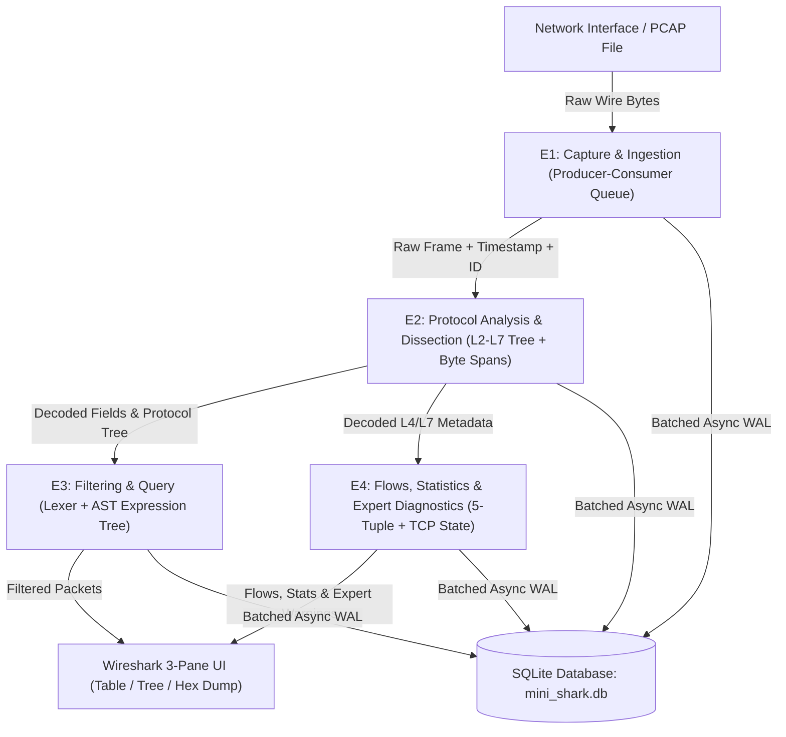

# Mini-Shark: Research Blueprint, DPI Architecture & Mathematical Foundations

**Course Project:** 23ECNP301 — Mini-Project (Team 07, CSE-AI)  
**Artefact:** Live Network Packet Capture and Protocol Analysis Tool ("Mini-Shark")  
**Institution:** KLE Technological University  
**Guide:** Prof. Pooja Shettar  

---

## 1. Academic & Engine Register Alignment

Based on the verified curriculum register (`project_spec.txt`):

| Engine | Approved Name | Student Owner | USN | Core Algorithmic Paradigm | Main Responsibilities |
| :---: | :--- | :--- | :---: | :--- | :--- |
| **E1** | **Capture & Ingestion** | **M Janaki** | `01fe24bci067` | Bounded Producer-Consumer Ring Buffer | Live wire packet capture, interface sniffing, PCAP/PCAPNG ingestion, nanosecond timestamping, and 50-pkt / 20ms queue flush. |
| **E2** | **Protocol Analysis & Packet Dissection** | **Chhavi Mishra** | `01fe24bci066` | Layered Recursive Dissector + Shannon Entropy | L2–L7 protocol parsing, field byte-span tracking, BLAKE2b-64 invariant key formulation, and DNS exfiltration entropy. |
| **E3** | **Filtering & Query / Correlation Hub** | **Hrishikesh Patil** | `01fe24bci043` | Lexer + AST Parser + Dual Hash Min-Heap | Wireshark display filter AST compiler (Mode 1), and TCP `:9000` multi-point correlation hub with 500ms sliding min-heap & drop localization (Mode 2). |
| **E4** | **Statistics, Flow & Expert Analysis** | **Vaibhav Kumar** | `01fe24bci0...` | 5-Tuple Flow Tracker + Deterministic Rules | Bidirectional conversation grouping, SQLite WAL persistence, 4 deterministic anomaly rules, FastAPI REST/WebSocket, and React UI. |



---

## 2. Deep Packet Inspection (DPI) & Wireshark Parity

Wireshark's core dissector architecture relies on two fundamental abstractions:
1. `tvbuff_t` (*Testy Virtual Buffer*): A bounded byte array slice with safe bounds checking to avoid out-of-bounds memory faults.
2. `proto_tree`: A hierarchical tree where each node references the exact byte offset range `(start_offset, length)` inside the raw packet frame.

### 2.1. Mini-Shark Dissection Architecture
Each protocol dissector in `backend/e2_dissection/protocols.py` inspects raw bytes and returns:
1. `name`: Protocol name (e.g., `Ethernet`, `IPv4`, `TCP`, `DNS`).
2. `fields`: Parsed key-value dictionary of header fields.
3. `field_spans`: Exact byte range `(start_offset, length)` within the raw frame.
4. `undecoded_bytes`: Trailing payload bytes dispatched to the next layer in the registry.

```text
Raw Packet Frame (14 + 20 + 20 + Payload bytes):
[ 0 .. 13 ]  Ethernet II Header     -> dst_mac [0:6], src_mac [6:12], ethertype [12:14]
[ 14 .. 33 ] IPv4 Header           -> ver_ihl [14], total_len [16:18], id [18:20], ttl [22], proto [23], src [26:30], dst [30:34]
[ 34 .. 53 ] TCP Header            -> sport [34:36], dport [36:38], seq [38:42], ack [42:46], flags [47:48], win [48:50]
[ 54 .. N  ] HTTP / DNS / Payload   -> application payload bytes
```

### 2.2. Supported Protocol Hierarchy
* **Layer 2 (Data Link):**
  * **Ethernet II:** Destination MAC, Source MAC, EtherType (`0x0800` IPv4, `0x86DD` IPv6, `0x0806` ARP, `0x8100` VLAN).
  * **ARP:** Hardware Type, Protocol Type, Opcode (Request `1`, Reply `2`), Sender MAC/IP, Target MAC/IP.
* **Layer 3 (Network):**
  * **IPv4:** Version, IHL, DSCP/ECN, Total Length, Identification, Flags (DF, MF), Fragment Offset, TTL, Protocol, Header Checksum, Source IP, Destination IP.
  * **IPv6:** Version, Traffic Class, Flow Label, Payload Length, Next Header, Hop Limit, Source/Destination IPv6.
* **Layer 4 (Transport):**
  * **TCP:** Source Port, Destination Port, Sequence Number, Acknowledgment Number, Data Offset, Flags (`SYN`, `ACK`, `FIN`, `RST`, `PSH`, `URG`, `ECE`, `CWR`), Window Size, Checksum, Urgent Pointer.
  * **UDP:** Source Port, Destination Port, Length, Checksum.
  * **ICMP / ICMPv6:** Type, Code, Checksum, Identifier, Sequence Number (Echo Request `8`, Echo Reply `0`).
* **Layer 7 (Application):**
  * **DNS (UDP/TCP 53):** Transaction ID, Flags (QR, Opcode, AA, TC, RD, RA, RCODE), QDCount, ANCount, recursive label decompression (`0xC0` pointer jumps).
  * **HTTP/1.x (TCP 80, 8080, 8000):** Request/Status line parsing, HTTP Method (`GET`, `POST`, `PUT`, `DELETE`), Request URI, HTTP Version, Headers map, Content-Length.
  * **TLS (TCP 443):** Handshake Content Type (`0x16`), Handshake Type (`0x01` Client Hello), TLS Version (`0x0303`), SNI (*Server Name Indication*) extension extraction.

---

## 3. Mathematical Formulations & Algorithms

### 3.1. Path-Invariant BLAKE2b-64 Fingerprinting
In multi-hop routing, packet headers are modified at every router hop (TTL decrements, IP checksum updates, MAC rewrites). To match observations of the same packet across different probes without full packet mirroring, E2 extracts only the path-invariant fields:

$$\text{InvariantKey} = \Big(\text{IP}_{\text{src}}, \; \text{IP}_{\text{dst}}, \; \text{IP}_{\text{proto}}, \; \text{IP}_{\text{id}}, \; \text{TCP}_{\text{seq}}, \; \text{TCP}_{\text{ack}}, \; \text{PayloadPrefix}_{0..16}\Big)$$

$$\text{Fingerprint} = \text{BLAKE2b}\Big(\text{CanonicalBytes}(\text{InvariantKey}), \; \text{digest\_size}=8\Big) \pmod{2^{64}}$$

### 3.2. One-Way Transit Latency & Multi-Hop Drop Localization
Given an ingress timestamp $T_1$ (Probe 11), intermediate transit timestamp $T_{\text{router}}$ (Probe 10), and egress timestamp $T_2$ (Probe 2):
* **One-Way Transit Delay:**
  $$\Delta T = T_2 - T_1$$
* **Multi-Hop Drop Localization:**
  $$\text{DropLocation} = \begin{cases}
  \text{Link 1 (Client } \to \text{ Router)} & \text{if } T_1 \text{ observed, } T_{\text{router}} \text{ not observed within } 500\text{ ms} \\
  \text{Link 2 (Router } \to \text{ Destination)} & \text{if } T_{\text{router}} \text{ observed, } T_2 \text{ not observed within } 500\text{ ms} \\
  \text{Unmatched Drop} & \text{if Router probe is offline and } T_2 \text{ not observed}
  \end{cases}$$

### 3.3. DNS Shannon Entropy for Data Exfiltration Detection
Data exfiltration attacks via DNS tunneling embed encrypted or base64/hex-encoded payloads inside subdomain labels (e.g. `a8f3b9c1d4e2.malicious.com`). While natural language domain names have low entropy ($H \approx 2.0 - 3.2$), encoded tunneling labels exhibit high informational entropy.

Mini-Shark computes Shannon entropy $H(X)$ over the character distribution of the query label:

$$H(X) = -\sum_{i=1}^{n} P(x_i) \log_2 P(x_i)$$

Where:
* $n$ is the number of distinct characters appearing in the domain string.
* $P(x_i) = \frac{\text{count}(x_i)}{\text{total length}}$.
* **Threshold:** If $H(X) > 4.2$ bits per character, Engine E4 raises a `DNS_EXFIL` diagnostic alert.

---

## 4. Engine E3: Lexer & Expression Tree Query Engine

Engine E3 implements a recursive-descent parser that translates Wireshark display filter strings into an Abstract Syntax Tree (AST), supporting both fast in-memory filtering and SQL query compilation.

### 4.1. Formal EBNF Grammar
```ebnf
Expression   := OrExpr
OrExpr       := AndExpr ( ("||" | "or") AndExpr )*
AndExpr      := NotExpr ( ("&&" | "and") NotExpr )*
NotExpr      := ("!" | "not") NotExpr | Primary
Primary      := "(" Expression ")" | Comparison | BareProtocol
Comparison   := FieldName Op Literal
Op           := "==" | "!=" | ">" | ">=" | "<" | "<=" | "contains" | "startswith" | "endswith"
BareProtocol := "tcp" | "udp" | "icmp" | "dns" | "http" | "arp" | "ip" | "tls"
FieldName    := "ip.src" | "ip.dst" | "ip.addr" | "ip.proto" | "tcp.port" | "tcp.seq" | "udp.port" | "dns.qry.name"
```

---

## 5. Engine E4: Canonical 5-Tuple Flow Aggregation

Bidirectional conversations are grouped using a normalized flow key:
$$\text{Endpoint}_A = (\text{IP}_A, \text{Port}_A), \quad \text{Endpoint}_B = (\text{IP}_B, \text{Port}_B)$$
$$\text{FlowKey} = \Big(\min(\text{Endpoint}_A, \text{Endpoint}_B), \; \max(\text{Endpoint}_A, \text{Endpoint}_B), \; \text{Protocol}\Big)$$

Each flow maintains:
* Packet count ($N$) and byte volume ($B = \sum \text{len}_i$).
* Flow start timestamp ($T_{\text{start}}$), end timestamp ($T_{\text{end}}$), and duration ($\Delta t = T_{\text{end}} - T_{\text{start}}$).
* Instantaneous throughput in bits/sec ($\text{bps} = \frac{8 \times B}{\max(0.001, \Delta t)}$) and packets/sec ($\text{pps}$).

---

## 6. Deterministic Diagnostic Rules

Engine E4 continuously evaluates four deterministic rules:

| Rule Name | Trigger Condition | Diagnostic Interpretation | Recommended Action |
| :--- | :--- | :--- | :--- |
| **`PACKET_LOSS`** | Unmatched drop rate $> 5\%$ over the sliding window. | Physical layer transmission errors, duplex mismatches, or buffer overflow drops. | Verify physical cabling, check interface drop counters (`netstat -s`), or inspect switch QoS drops. |
| **`BUFFERBLOAT`** | One-way transit latency $\Delta T > 20\text{ ms}$ with high variance ($> 15\text{ ms}$ jitter). | Excessive packet buffering in intermediate router FIFO queues. | Enable Active Queue Management (AQM) such as FQ-CoDel or CAKE; reduce router queue depth. |
| **`APP_FREEZE`** | Packets flow normally but remote application stops ACKing or advertises ZeroWindow. | Server process deadlock, memory exhaustion, or garbage collection stall. | Inspect destination application thread dumps, heap memory usage, or host CPU load. |
| **`DNS_EXFIL`** | DNS query name Shannon entropy $H(X) > 4.2$ bits. | Covert data exfiltration tunnel embedding base64/hex data in DNS subdomains. | Block queried domain at DNS firewall; inspect client process issuing the queries. |

---

## 7. Unified Database Architecture (SQLite WAL)

Mini-Shark standardizes on `mini_shark.db` utilizing Write-Ahead Logging (`PRAGMA journal_mode = WAL`) and prepared statements to achieve $> 25,000$ operations/sec:

```sql
CREATE TABLE IF NOT EXISTS captures (
    id INTEGER PRIMARY KEY AUTOINCREMENT,
    name TEXT NOT NULL,
    timestamp REAL NOT NULL,
    packet_count INTEGER DEFAULT 0,
    flow_count INTEGER DEFAULT 0
);

CREATE TABLE IF NOT EXISTS packets (
    id INTEGER PRIMARY KEY AUTOINCREMENT,
    capture_id INTEGER NOT NULL REFERENCES captures(id),
    packet_index INTEGER NOT NULL,
    timestamp REAL NOT NULL,
    length INTEGER NOT NULL,
    raw_bytes BLOB NOT NULL
);

CREATE TABLE IF NOT EXISTS layers (
    id INTEGER PRIMARY KEY AUTOINCREMENT,
    capture_id INTEGER NOT NULL REFERENCES captures(id),
    packet_index INTEGER NOT NULL,
    layer_name TEXT NOT NULL,
    fields_json TEXT NOT NULL
);

CREATE TABLE IF NOT EXISTS flows (
    id INTEGER PRIMARY KEY AUTOINCREMENT,
    capture_id INTEGER NOT NULL REFERENCES captures(id),
    flow_id INTEGER NOT NULL,
    five_tuple TEXT NOT NULL,
    packet_count INTEGER NOT NULL,
    byte_count INTEGER NOT NULL,
    start_ts REAL,
    end_ts REAL,
    duration REAL
);

CREATE TABLE IF NOT EXISTS correlations (
    id INTEGER PRIMARY KEY AUTOINCREMENT,
    fingerprint INTEGER NOT NULL,
    match_state TEXT NOT NULL,
    t1_ns INTEGER,
    t2_ns INTEGER,
    delay_ns INTEGER,
    flags INTEGER DEFAULT 0,
    probe1_seq INTEGER,
    probe2_seq INTEGER,
    created_at_ns INTEGER NOT NULL,
    drop_link TEXT
);

CREATE TABLE IF NOT EXISTS diagnostic_alerts (
    id INTEGER PRIMARY KEY AUTOINCREMENT,
    category TEXT NOT NULL,
    severity TEXT NOT NULL,
    confidence TEXT NOT NULL,
    detected_at_ns INTEGER NOT NULL,
    recommended_action TEXT NOT NULL,
    evidence_json TEXT NOT NULL,
    metrics_json TEXT NOT NULL
);
```
