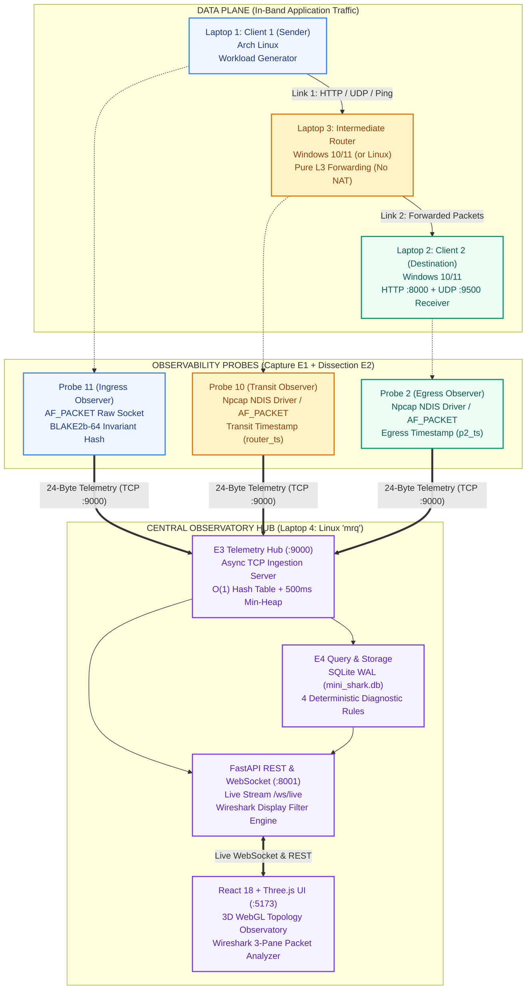
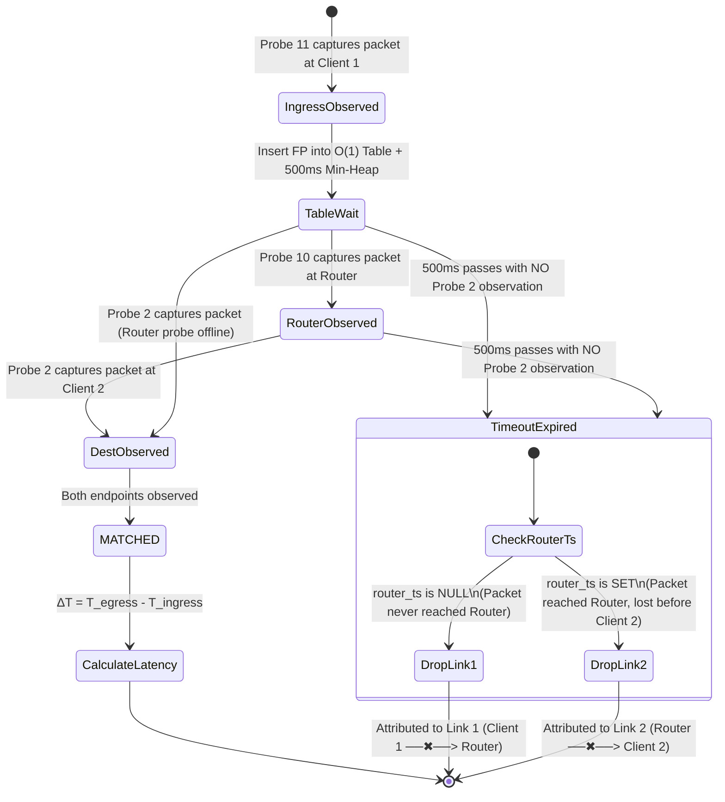

# Mini-Shark System Architecture & Network Specification

**Course Project:** Network Traffic Monitoring & Protocol Analysis (`23ECNP301`)  
**Team 07:** Mini-Shark Distributed Silent Drop Localization Testbed  

---

## 1. High-Level Dual-Plane System Architecture

Mini-Shark enforces strict separation between the **In-Band Data Plane** (application traffic flowing across client nodes and router) and the **Out-of-Band Telemetry Plane** (fingerprint telemetry streaming to the central monitoring hub).



---

## 2. 4-Engine Internal Processing Pipeline (E1 – E4)

```mermaid
flowchart LR
    classDef e1 fill:#E0F2FE,stroke:#0284C7,stroke-width:2px,color:#0369A1;
    classDef e2 fill:#EDE9FE,stroke:#7C3AED,stroke-width:2px,color:#5B21B6;
    classDef e3 fill:#FEF3C7,stroke:#D97706,stroke-width:2px,color:#92400E;
    classDef e4 fill:#DCFCE7,stroke:#16A34A,stroke-width:2px,color:#15803D;

    subgraph E1 ["Engine E1: Capture"]
        Raw["Raw Wire Frames"]:::e1
        Drv["Linux AF_PACKET / Win Npcap"]:::e1
        Pkt["Packet(raw_bytes, ts)"]:::e1
        Raw --> Drv --> Pkt
    end

    subgraph E2 ["Engine E2: Dissection & Fingerprinting"]
        Walk["Layer Walker\n(Ethernet, IPv4, TCP, UDP, DNS, ICMP)"]:::e2
        Inv["Invariant Field Extractor\n(Exclude TTL, Checksum, MACs)"]:::e2
        Hash["BLAKE2b-64 Invariant Digest\n(8-byte Digest + Entropy H)"]:::e2
        Rec["24-Byte Packed Telemetry\n[FP:8B | TS:8B | Seq:4B | Meta:4B]"]:::e2
        Walk --> Inv --> Hash --> Rec
    end

    subgraph E3 ["Engine E3: Correlation Hub"]
        Ingest["TCP Ingestion (:9000)\nNagle Disabled (TCP_NODELAY)"]:::e3
        Table["O(1) In-Flight Hash Table\nKey = 64-bit BLAKE2b FP"]:::e3
        Heap["500ms Sliding Window Min-Heap\nPriority Queue on deadline_ns"]:::e3
        Match{"Match Status?"}:::e3
        Ingest --> Table & Heap --> Match
    end

    subgraph E4 ["Engine E4: Query & Diagnostics"]
        Store[("SQLite WAL Storage\nmini_shark.db")]:::e4
        Rules["Deterministic Diagnostic Rules:\n1. Link 1 Drop (Client ──✖──> Router)\n2. Link 2 Drop (Router ──✖──> Dest)\n3. Latency Spike (ΔT > 20ms)\n4. DNS Tunneling (H > 4.2 bits)"]:::e4
        Match -- "Matched (ΔT = T2 - T1)" --> Store
        Match -- "Unmatched Timeout" --> Rules --> Store
    end

    Pkt --> Walk
    Rec -- "Network Stream" --> Ingest
```



---

## 3. Path-Invariant Fingerprinting Specification (E2)

In standard networks, routers modify packet headers in transit:
1. **TTL Decrement**: Decremented by 1 at each L3 hop.
2. **IP Header Checksum**: Recalculated due to TTL change.
3. **Ethernet MAC Addresses**: Rewritten at every L2 hop.

Mini-Shark solves this by hashing **only path-invariant fields**:

```text
┌────────────────────────────────────────────────────────────────────────┐
│                   Path-Invariant BLAKE2b-64 Hashing                    │
├────────────────────────────────┬───────────────────────────────────────┤
│ INCLUDED IN HASH (Invariant)   │ EXCLUDED FROM HASH (Mutating)         │
├────────────────────────────────┼───────────────────────────────────────┤
│ • IPv4 Source & Dest IP        │ ✖ Ethernet Source & Dest MACs         │
│ • IPv4 Protocol Number         │ ✖ IPv4 Time-to-Live (TTL)             │
│ • IPv4 Identification (IP ID)  │ ✖ IPv4 Header Checksum                │
│ • TCP/UDP Source & Dest Ports  │ ✖ TCP Window Size & Flags (ECE/CWR)   │
│ • TCP Sequence Number          │ ✖ TCP Checksum                        │
│ • L4 Application Payload       │ ✖ UDP Checksum                        │
└────────────────────────────────┴───────────────────────────────────────┘
```

**Mathematical Invariant:**
$$\text{FP}_{\text{Client 1}}(\text{Packet}) = \text{FP}_{\text{Router}}(\text{Packet}) = \text{FP}_{\text{Client 2}}(\text{Packet})$$

---

## 4. Silent Drop Localization State Machine (E3)

Mini-Shark accurately localizes which physical segment dropped the packet:



---

## 5. Physical Testbed Topology & IP Map

```text
                      ┌────────────────────────────────────────┐
                      │  Campus Wi-Fi / Mobile Hotspot Network  │
                      │            (10.108.157.0/24)           │
                      └───────────────────┬────────────────────┘
                                          │
       ┌───────────────────┬──────────────┴──────┬───────────────────┐
       ▼                   ▼                     ▼                   ▼
┌──────────────┐    ┌──────────────┐      ┌──────────────┐    ┌──────────────┐
│   Laptop 1   │    │   Laptop 3   │      │   Laptop 2   │    │   Laptop 4   │
│   Client 1   │    │    Router    │      │   Client 2   │    │  Server Hub  │
│ (Arch Linux) │    │ (Windows 11) │      │ (Windows 11) │    │(Linux 'mrq') │
│              │    │              │      │              │    │              │
│ 10.108.157.x │    │ 10.108.157.2 │      │10.108.157.179│    │10.108.157.52 │
│ Probe 11     │    │ Probe 10     │      │ Probe 2      │    │ E3: TCP :9000│
│ Traffic Gen  │    │ Pure L3 Fwd  │      │ Receiver:    │    │ API: :8001   │
│ Workloads    │    │ Fault Inject │      │ :8000 / :9500│    │ UI:  :5173   │
└──────────────┘    └──────────────┘      └──────────────┘    └──────────────┘
       │                   │                     │                   ▲
       │                   │                     │                   │
       └───── Link 1 ─────▶└────── Link 2 ──────▶│                   │
                                                 │                   │
       └────────────────── Telemetry Plane (TCP :9000) ──────────────┘
```
